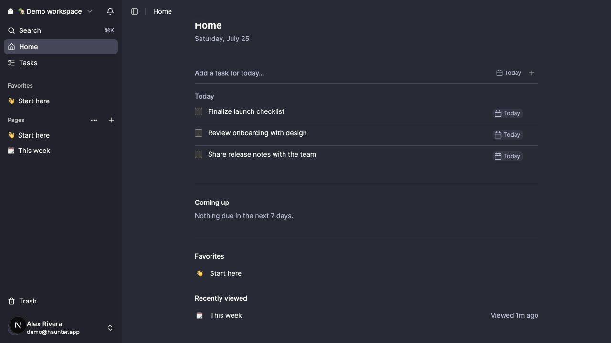
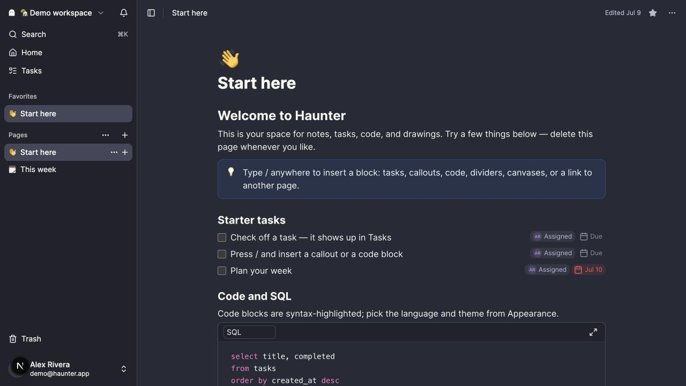

# Haunter

Haunter keeps notes, tasks, and canvases together. Write in nested pages, keep
tasks next to the thinking behind them, and sketch ideas without switching
tools.

Let an AI client help without opening up your entire account. You decide what
each client can do and which workspaces it can reach.

[Open Haunter](https://haunter.app) ·
[Read the guides](https://haunter.app/guides) ·
[View the changelog](https://haunter.app/changelog)





## What you can do

- **Start with what matters.** Home gives you one view of overdue tasks, tasks
  due today or in the next seven days, favorites, and recently viewed pages and
  canvases.
- **Build connected notes.** Use nested pages, search, and backlinks to keep
  ideas connected. Attach files, revisit page history, and publish read-only
  links.
- **Think visually.** Keep a canvas inside the page it belongs to or give it a
  place of its own. Start from a diagram or wireframe template, then arrange
  fully editable building blocks.
- **Keep tasks in context.** Tasks can live inside a page or on their own.
  Assign them to workspace members, write due dates in natural language, add
  due times, and manage them from the workspace task list.
- **Work together with clear boundaries.** Workspace roles separate viewing,
  editing, and member management. Edit pages and canvases together in real time.
- **Take your pages with you.** Move pages in or out as Markdown, or create
  standalone HTML in your chosen Haunter theme.
- **Connect AI on your terms.** Use Haunter's hosted MCP server or a local Agent
  Auth bridge with supported AI clients. Choose a permission profile and
  workspaces, review recent activity, and disconnect a client at any time.

## Run Haunter locally

To run Haunter locally, install Bun 1.4.x. The default setup stores data in a
local libSQL database and prints passwordless sign-in codes in the terminal,
so you can sign in without configuring an email provider.

### 1. Clone and install Haunter

```bash
git clone https://github.com/taylorbryant/haunter.git
cd haunter
bun install
cp .env.example .env.local
```

### 2. Choose the first administrator

Add `BOOTSTRAP_ADMIN_EMAIL` to `.env.local` with the email address for the first
app administrator:

```env
BOOTSTRAP_ADMIN_EMAIL=owner@example.com
```

On a fresh installation, the first verified account matching that address
becomes the app-wide administrator. The setting is ignored after an
administrator has been approved.

### 3. Create the database and sign in

```bash
bun beignet db migrate
bun run dev
```

In a second terminal, from the same directory, start the collaboration worker:

```bash
bun run dev:collaboration
```

Keep both processes running. The defaults in `.env.local` connect the app to the
worker at `ws://localhost:1234`, using the same local database.

Open [http://localhost:3000/sign-in](http://localhost:3000/sign-in), request a
code for the configured email address, and copy the six-digit code from the
server console. The first sign-in continues through workspace onboarding.

If the account was created before `BOOTSTRAP_ADMIN_EMAIL` was configured, leave
it on the waitlist and run:

```bash
bun run bootstrap-admin --email owner@example.com
```

Sign out and back in after the command completes so the new administrator role
is reflected in the browser session.

## Development

### Validate changes

The tests require `redis-server` on your PATH (`brew install redis` on macOS,
`sudo apt-get install redis-server` on Ubuntu), or an explicit
`REDIS_SERVER_BINARY` path. Redis tests start a temporary instance with a private
Unix socket and persistence disabled; they never use your configured Redis service.

Run the full validation loop after making changes:

```bash
bun beignet check
```

The command runs Beignet's dependency-direction lint and strict doctor checks,
then the app's Biome lint, type check, and tests. Every check runs even when an
earlier check fails. Use `bun run format` to apply Biome formatting.

See [Editor benchmarks](docs/editor-benchmarks.md) for document benchmarks and
browser checks covering page readiness, typing, and synchronization.

### Project structure

- `app/` contains Next.js routes and layouts.
- `features/` groups contracts, use cases, UI, and tests by product feature.
- `ports/` defines app dependencies; `infra/` implements them.
- `server/` composes routes, providers, and background work.
- `components/` and `client/` contain shared browser code.
- `infra/db/schema/` defines the database; `drizzle/` contains migrations.

See [AGENTS.md](AGENTS.md) for generators, registration requirements, and coding
conventions.

## Technical documentation

Product instructions live in the [Haunter guides](https://haunter.app/guides).
The documents below cover running Haunter and integrating clients.

| Topic | Reference |
| --- | --- |
| Deploying the app | [Deployment and configuration](docs/deployment.md) |
| Collaborative editing | [Worker operation, persistence, and recovery](docs/collaboration.md) |
| Workspace access | [Membership authorization](docs/membership-authorization.md) |
| MCP tools | [Pages](docs/mcp-page-editing.md), [canvases](docs/mcp-canvas-editing.md), [files](docs/mcp-files.md), [content management](docs/mcp-content-management.md), [search](docs/workspace-search.md) |
| Agent context and feedback | [Live context](docs/mcp-live-context.md), [canvas activity](docs/mcp-canvas-activity.md) |
| Embedded editor | [MCP App integration](docs/mcp-app.md) |
| UI maintenance | [Keyboard focus](docs/keyboard-focus.md), [editor benchmarks](docs/editor-benchmarks.md) |
