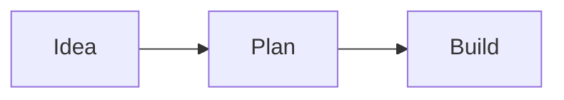

A page can hold text, tasks, tables, code, files, and drawings. Start with one page for a topic, then organize related pages beneath it or link them together.

## Write with blocks

Each paragraph, heading, list item, or drawing is a **block**. You can add blocks as you write and move them around later.

1. Open a page and click or tap in its body.
2. Type `/` on a new line to open the insert menu. Search for a block by name or choose one from the list.
3. Start with headings and paragraphs. Add lists, a quote, or a callout when they help organize your thinking.

Select text to make it bold or italic, or turn it into a link. On mobile, formatting controls appear above the keyboard while you edit. Highlighted controls show which formatting is applied to the selected text.

Use the handle beside a block to open its menu or drag it to another position on desktop. You can edit the page title directly and choose an icon above it.

## Add tables, code, and files

Choose **Table** from the `/` menu to organize information into rows and columns. Click a cell to edit it, and use the table controls to add or remove rows and columns.

Choose **Code Block** for source code, then select its language for syntax highlighting. Use **Expand code** to edit in a larger view. To remove the block, open its options menu and choose **Delete**.

Choose **Image** or **File** from the insert menu and use the block's upload controls. This keeps a reference image or document alongside your notes.

For work you want to track or draw, insert a [task](/guides/tasks#add-a-task-inside-a-page) or [canvas](/guides/canvases#draw-inside-a-page).

## Add a Mermaid diagram

Choose **Mermaid** from the `/` menu to start with a small flowchart. You can also choose **Mermaid** as a code block's language or import a Markdown file with a fenced `mermaid` block.

Use **Source** to edit the diagram's text and **Diagram** to see the result. **Expand code** gives you more room for either view. Diagrams use the page's theme and adapt to the available width; zoom controls appear when a diagram needs more room.

For example:

Mermaid supports flowcharts, sequence diagrams, entity relationship diagrams, and other diagram types. If the source has an error, Haunter shows a message and keeps the text available to fix. Links and external images inside diagrams are disabled.

Diagrams appear on shared pages too. Markdown exports retain the Mermaid source; HTML exports include the diagram and its source. You can also ask a connected AI agent to create or update a Mermaid diagram on a page.

## Organize and connect pages

- **Create a subpage:** open a page's menu in the sidebar and choose **Add subpage**. You can also type `/` in the editor and choose **Page** to create a subpage with a link in your notes.
- **Mention an existing page:** type `@`, then choose a page in the workspace. Select the mention later to open it.
- **Reorganize pages:** on desktop, drag a page in the sidebar to change its position or nest it under another page.
- **Keep a favorite:** select the star in the page header or choose **Add to favorites** from its sidebar menu.

**Backlinks** show which other pages link to the page you are reading. Use them to follow connections between meeting notes, project plans, and reference material.

## Search across your workspace

1. Select **Search** in the sidebar, or press **Cmd+K** on Mac or **Ctrl+K** on Windows and Linux.
2. Enter at least two characters from a title or the content you remember.
3. Choose **All**, **Pages**, **Tasks**, or **Canvases** to narrow the results.
4. Select a result to open it.

Search includes saved page text, task titles, canvas titles, and text inside drawings. When text in a drawing matches, the result takes you to that shape, even if the drawing is inside a page. A task result opens that task in the Tasks view; choose **Show all tasks** to return to the full list.

Type `>` in Search to find commands instead of content. Choose **Keyboard shortcuts** to see the shortcuts for navigating Haunter, creating pages and tasks, editing pages, and drawing on canvases.

Search does not read text in images or attached files, and it excludes deleted pages and older versions. To find those, use [Trash or page history](/guides/saving-and-recovery).

## Bring notes in or take them with you

Open the menu beside **Pages** and choose **Import Markdown** to bring in a Markdown file.

To download a page, open its header's options menu and choose a Markdown or HTML export. [Read about export formats](/guides/sharing-and-exporting#export-a-page) before using them as a backup.
